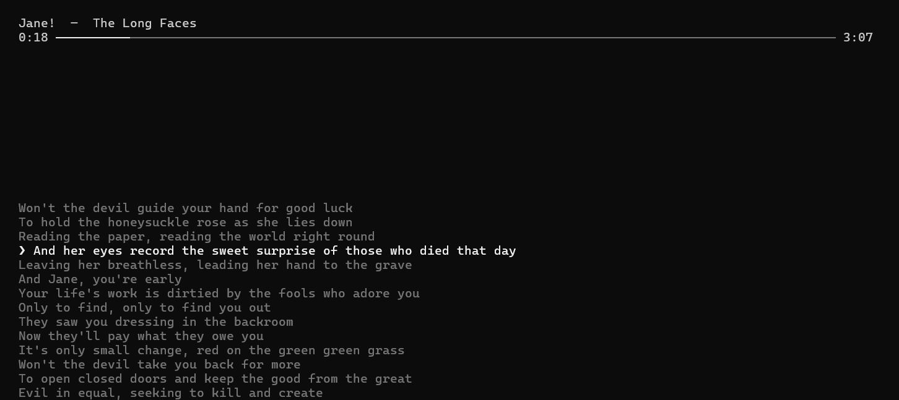

# Lyricly

<p align="center">
  
</p>

<p align="center">
  A Python application that displays the lyrics of the song you're currently listening to.
</p>

<p align="center">
  Control your music, adjust the volume, skip tracks, and more — all in one place.
</p>

---

## Features

- **Live Lyrics** — Display the lyrics of the song you're currently listening to.
- **Music Controls** — Skip tracks and control your playback.
- **Volume Control** — Adjust the volume directly from the application.
- **More Features** — Additional tools for a better music listening experience.
- **More Controls** — Press "?" for all controls.

## Built With

- Python

## Getting Started

### Prerequisites

Make sure you have Python installed on your system.

- [Download Python](https://www.python.org/downloads/)

### Installation

1. Clone the repository:

   ```bash
   git clone https://github.com/devjayosch/Lyricly.git
   ```

2. Navigate to the project directory:

   ```bash
   cd Lyricly
   ```

3. Run the application:

   ```bash
   python main.py
   ```

## Project Status

Lyricly is a project in development. More features and improvements may be added over time.

## License

This project is open source. A license will be added if applicable.
